# 律衡（LexBench）用户手册

- 适用版本：0.3.0（Pre-release 测试版）
- 目标平台：macOS 13 及以上（Apple Silicon）；Windows 10/11 64 位（本测试版尚未完成实机验收）。最低系统版本依据运行时要求，未逐版本实测。
- 软件许可：GPL-3.0-only，© OberynKC

> **重要提示**：0.3.0 是测试版本，请勿用于真实办案数据。律衡是一款本地工作台软件，不提供法律意见；案件期限、保全期限等全部由您手工录入，请自行核对日期与法律依据。

## 目录

1. [软件简介](#一软件简介)
2. [下载、安装与首次初始化](#二下载安装与首次初始化)
3. [界面概览与基本操作](#三界面概览与基本操作)
4. [客户管理](#四客户管理)
5. [案件管理](#五案件管理)
6. [合同、收费与发票](#六合同收费与发票)
7. [待办事项与日程](#七待办事项与日程)
8. [保全执行](#八保全执行)
9. [办案笔记](#九办案笔记)
10. [全局搜索](#十全局搜索)
11. [期限提醒](#十一期限提醒)
12. [设置、演示数据与数据管理](#十二设置演示数据与数据管理)
13. [数据位置、备份迁移与常见问题](#十三数据位置备份迁移与常见问题)

## 一、软件简介

律衡是面向中国执业律师的个人工作台，以「案件」为轴心组织客户、合同、收费、发票、待办、日程、保全执行与办案笔记。全部数据保存在您本机的 SQLite 数据库与本地附件目录中，不联网、不上传。

主要功能：

- 客户 / 案件 / 合同三层结构，案件按程序模板显示办理阶段
- 合同收费期次、发票登记与收费进度统计
- 待办与日程联动、保全期限预警、提醒中心与系统通知
- 办案笔记（Markdown、草稿自动保存、最近 20 版历史与恢复副本）
- 全局搜索（七类数据，⌘K / Ctrl+K）
- Excel 十表导出、附件 ZIP、完整备份与恢复
- 明暗主题，中文界面

功能边界：律衡不计算法定期限，不提供法律检索，不自动生成法律文书；所有期限、金额、案件信息均由您录入，软件只做记录、组织与提醒。

## 二、下载、安装与首次初始化

### 2.1 下载与校验

从 Releases 页面下载对应平台的安装包、`SHA256SUMS.txt` 与本手册 PDF。在下载目录计算安装包的 SHA-256 值：

```bash
# macOS（终端）
shasum -a 256 LexBench-0.3.0-macos-arm64.dmg

# Windows（PowerShell）
Get-FileHash .\LexBench-0.3.0-windows-x64.exe -Algorithm SHA256
```

将输出的哈希值与 `SHA256SUMS.txt` 中同名文件所在行比对（大小写不影响比对结果），一致后再安装。

### 2.2 安装

- **macOS**：打开 DMG，将「律衡」拖入「应用程序」。本测试版为 ad-hoc 签名、未经过苹果公证，首次打开时可能提示无法验证开发者。先核对下载来源和哈希，再查看「系统设置 → 隐私与安全性」是否提供「仍要打开」。如提示文件已损坏、包含恶意软件或哈希不一致，请停止安装并反馈。详细步骤见 [安装升级说明](installation.md)。
- **Windows**：运行 NSIS 安装程序。本测试版未签名，SmartScreen 可能提示「Windows 已保护你的电脑」；核对来源和哈希、确认愿意试用后，可点击「更多信息 → 仍要运行」。卸载程序默认保留您的数据目录。

### 2.3 首次初始化

首次启动会要求填写姓（必填）与名（可空），用于界面问候语与头像显示，保存在本机数据库中，可随时在设置中修改。


点击「开始使用」后进入仪表盘。此时应用内没有任何数据。建议按以下顺序录入：先建客户，再建案件（案件的委托人只能从已有客户中选择），然后在案件下登记合同、待办、日程、保全与笔记。如只想熟悉功能，可按第 12.2 节导入虚构的演示数据。

## 三、界面概览与基本操作


### 3.1 界面布局

- **左侧导航**：仪表盘、案件管理、日程表、待办事项、保全执行、办案笔记（工作台组）；客户管理、合同管理（业务资料组）；底部为设置。
- **顶栏**：当前页面标题、全局搜索入口（⌘K / Ctrl+K）、期限提醒铃铛（带未读数量）、明暗主题切换、头像与姓名。首次使用时主题跟随系统外观，手动切换后按您的选择保持。

仪表盘的内容：

- **快捷按钮**：日期行右侧有「新建待办」「新建日程」「新建笔记」「新建案件」四个按钮。
- **统计条**：显示案件总数、未完成待办、7 天内及逾期待办、保全 / 执行预警四项数字，点击可进入对应页面。
- **左列**：待办事项与保全 / 执行到期预警摘要，各显示前 6 条，可点击「查看全部」进入列表。
- **右列**：月历小日历与今日日程。小日历用圆点标示当天的日程，农历只在「日程表」页面显示。

### 3.2 基本操作约定

- 列表中的名称、徽章和「查看案件」等链接可直接点击，进入对应详情。
- 删除、恢复数据等不可撤销的操作均有中文确认弹窗，默认选项为「取消」。
- 进行数据导出、备份或恢复时，页面顶部会出现琥珀色提示条：「正在准备或执行导出、备份或恢复，暂时不能保存、上传或删除；可以继续查看。」操作结束后提示条消失，即可继续编辑。
- 如果出现「保存失败」提示，应用会停止后续保存，并重新载入数据库中最后一次保存成功的内容。提示出现前尚未保存的修改需要重新录入。

### 3.3 可删除的数据

| 数据 | 能否在应用内删除 | 删除时一并删除的内容 |
| --- | --- | --- |
| 客户 | 不能 | — |
| 案件 | 不能 | — |
| 保全执行记录 | 不能；办结后可改为结束状态 | — |
| 合同 | 能，需确认 | 收费期次、发票、合同与发票附件 |
| 收费期次 | 能，需确认 | — |
| 发票 | 能，需确认 | 该发票的附件 |
| 待办 | 能，需确认 | 该待办自动生成的日程 |
| 手工新建的日程 | 能，需确认 | — |
| 待办自动生成的日程 | 不能单独删除；取消待办期限或删除待办时自动删除 | — |
| 办案笔记 | 能，需确认 | 该笔记的草稿与全部历史版本 |
| 附件 | 能，需确认 | 应用数据目录中的附件文件 |

## 四、客户管理

「客户管理」列表展示全部客户的名称、类型（个人/企业）、电话、邮箱、名下案件数与备注，支持按名称/电话搜索，右上角「新建客户」。新建客户时「姓名 / 名称」必填，类型、电话、邮箱、地址与备注可选填。

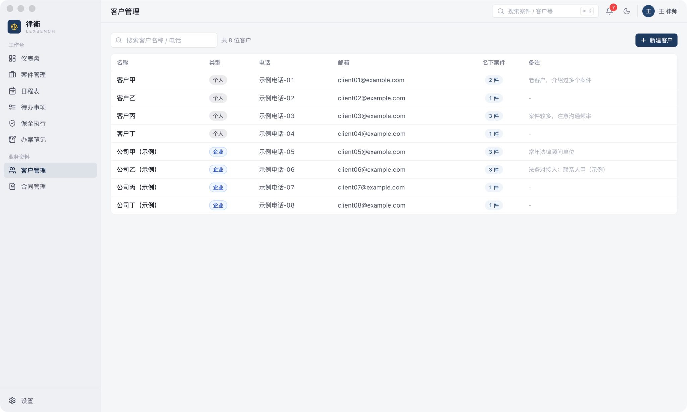

点击客户名称进入客户详情：左侧为联系信息与备注，右侧上方为其名下案件（名称、类型、阶段、标的额、收案日期），下方为其委托代理合同（合同编号、收费方式、约定律师费、应收/实收、关联案件、签约日期、状态）。可点击「编辑客户」修改信息；在此新建合同会锁定该客户。

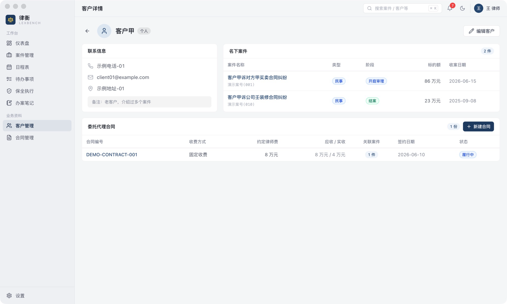

## 五、案件管理

### 5.1 案件列表与新建案件

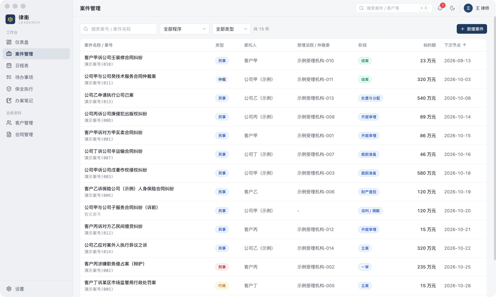

列表显示案件名称 / 案号、类型、委托人、受理法院 / 仲裁委、阶段、标的额与下次节点，点击「下次节点」表头可切换升序或降序。可按案号或案件名称搜索，并按「案件类型」和「程序」两项筛选。

案件类型与程序模板共 5 类 22 种：

- **民事**：民事·诉前、民事一审、民事二审、民事再审、民事执行、民事特别程序
- **刑事**：刑事辩护（公诉）、刑事·被害人代理、刑事自诉
- **行政**：行政复议、行政一审、行政二审、行政再审、行政裁判执行、行政非诉执行
- **仲裁**：商事仲裁、劳动仲裁
- **非诉**：常年法律顾问、专项交易（尽调/并购）、企业合规、破产管理、非诉通用

点击右上角「新建案件」，填写以下内容：

- **必填**：案件名称、案件类型、程序模板、代理立场、当前阶段、委托人、收案日期。委托人从已有客户中选择，请先在「客户管理」中建立客户。
- **选填**：案号、对方当事人、受理法院 / 仲裁委、承办法官 / 仲裁员、联系方式、标的金额、下次关键节点、备注。

切换案件类型或程序模板时，代理立场和当前阶段会重新设为该模板的默认值。新建案件时，「当前阶段」只列出可作为收案起点的阶段；编辑案件时可选择该模板的全部阶段。

### 5.2 案件详情与阶段

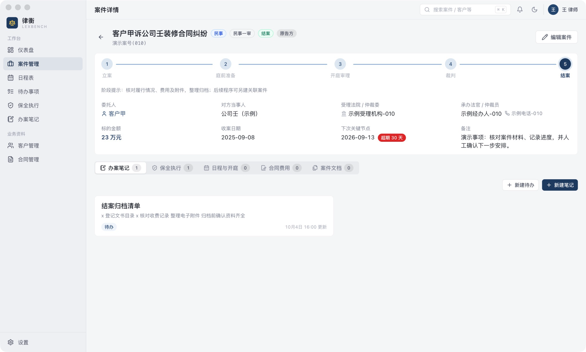

案件详情顶部为程序阶段进度条（如民事一审：立案 → 庭前准备 → 开庭审理 → 裁判 → 结案），当前阶段高亮显示，下方一行显示「阶段提示：……」。案件处于发回重审、律师函等分支阶段时，显示「当前处于分支阶段：××」。阶段提示只是一般性的工作事项提醒，不引用、不代替法律规定；法定期限请自行核对并手工录入。

**推进阶段**：点击右上角「编辑案件」，修改「当前阶段」后保存。

主体信息包括：委托人、对方当事人、受理法院/仲裁委、承办法官/仲裁员及联系方式、标的金额、收案日期、下次关键节点、备注。

关于「下次关键节点」：

- 该日期旁的徽章按剩余天数着色，规则与待办期限相同（见第 7.1 节）。
- 未填写时，系统按收案日期保存该字段，因此较早收案的案件可能显示「超期 N 天」。请在新建或编辑案件时填写实际日期。
- 该日期**不进入提醒中心，也不发送系统通知**。需要提醒的期限请在案件下另建一条带期限的待办。

下方标签页汇总该案件的办案笔记、保全执行、日程与开庭、合同费用、案件文档。各标签页可直接新建对应内容：办案笔记页可新建待办和笔记，保全执行页可新建记录，日程与开庭页可新建日程，合同费用页可新建合同。

### 5.3 案件附件

在「案件文档」标签页点击「上传文件」，可一次选择一个或多个文件。上传时文件会被复制到本机数据目录的 `attachments/` 中，数据库只保存文件名、大小和存放位置，应用内不记录文件的原始路径。上传后修改或删除原文件，不影响应用内保存的副本；如原文件更新，请重新上传。

每个附件可「打开」「打开所在文件夹」或「删除」（删除需确认）。标有「旧版仅元数据」的附件只登记了文件信息、没有保存文件内容，无法打开（演示数据中的附件即属此类）。

## 六、合同、收费与发票

### 6.1 合同总表与新建合同

「合同管理」为合同总表，显示合同名称 / 编号、所属客户、关联案件、总金额、收费进度（已收 / 应收）与状态，可按客户筛选、按合同名称/编号搜索。

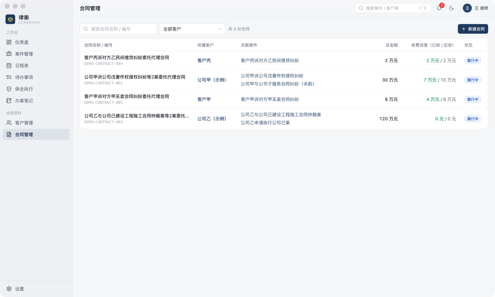

合同名称由系统自动生成，不需要填写：

- 关联 1 个案件：「<案件名称>委托代理合同」
- 关联多个案件：「<第一个案件名称>等 N 案委托代理合同」
- 未关联案件：「<客户名称>委托代理合同」

新建合同时，合同编号、委托人、约定律师费为必填；签约日期、收费方式（固定收费、风险代理、半风险代理、计时收费）、合同状态（履行中、已完结、已解除）、关联案件（可多选）与备注可选填。从客户详情新建时会锁定该客户；从案件详情新建时会预选该案件及其委托人。

### 6.2 合同详情、收费期次与发票

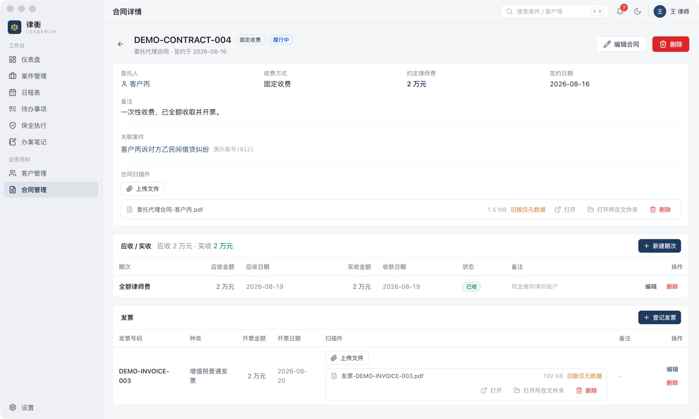

合同详情依次显示合同基本信息、关联案件、合同扫描件，以及「应收 / 实收」和「发票」两个表格。

- **收费期次**：点击「新建期次」，填写期次名称（必填，如「首期款」「尾款」）、应收金额（必填）、应收日期（默认当天）、实收金额、收款日期与备注。表头汇总应收、实收及未收金额。每个期次只记录一个实收金额和最近一次收款日期；同一期分多笔到账时，可在备注中记录明细。
- **收款状态**由系统按规则显示，见下表。
- **发票**：点击「登记发票」，填写发票号码（必填）、发票种类（增值税普通发票、增值税专用发票）、开票金额（必填）、开票日期与备注。每张发票可单独上传扫描件。
- 应收日期只用于显示收款状态，**不进入提醒中心，也不发送系统通知**；需要催收提醒时，请另建带期限的待办。
- 删除合同会**同时删除**其全部收费期次、发票及相关附件。操作前有确认提示，提示中列出将删除的期次和发票数量，请谨慎操作。

| 收款状态 | 判断规则 |
| --- | --- |
| 已收 | 实收金额不少于应收金额 |
| 部分收 | 已有实收但少于应收金额，且应收日期未过 |
| 未收 | 实收为 0，且应收日期未过 |
| 逾期 | 应收日期已过，且尚未收足 |

## 七、待办事项与日程

### 7.1 待办事项

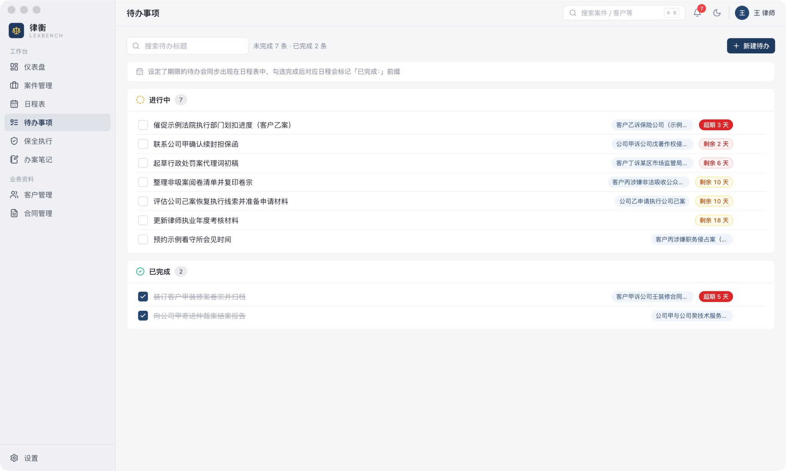

新建待办时标题必填，关联案件和期限可选填。待办分「进行中」「已完成」两组，可按标题搜索，点击勾选框切换完成状态。期限按剩余天数着色：红底白字为已超期，红色为 7 天内（含当天），琥珀色为 8–60 天，灰色为 60 天后。**期限由您手工录入，软件不计算法定期限。**

设定了期限的待办会在日程表同步生成一条「截止期限」日程，时间固定为期限当天 09:00–10:00，日程的「提醒」栏自动填写「当天 09:00」。这一栏只是文字备注，到时不会弹出通知；待办的系统通知规则见第十一章。

勾选完成后，该日程标题前加「已完成：」，恢复未完成时去掉。修改待办的标题、关联案件或期限时，日程同步更新；取消期限或删除待办时，对应日程一并删除。这类日程不能在日程表中手工编辑，请在待办中修改。

### 7.2 日程表

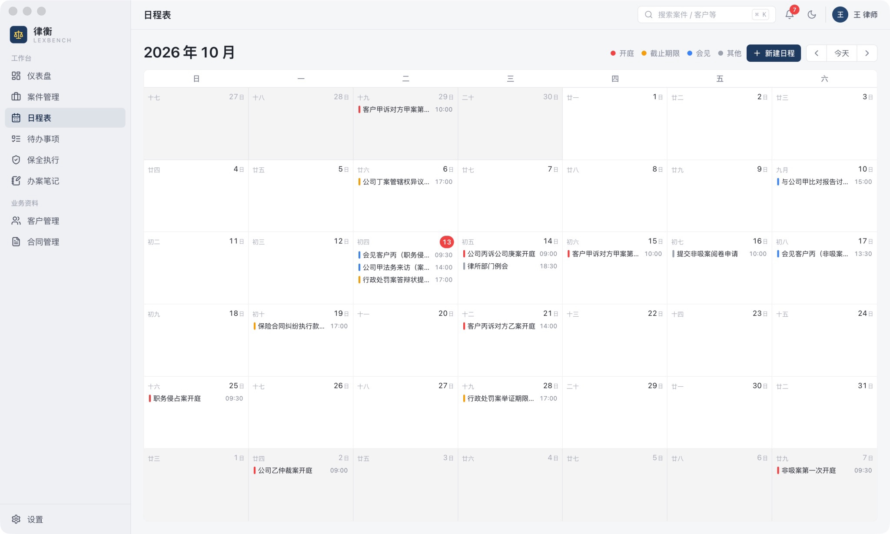

月视图以周日为每周起始日，日期同时显示农历（初一显示月份）。每个日期格最多显示 3 条日程，其余显示为「+N 更多」。日程按类型着色：开庭（红）、截止期限（琥珀）、会见（蓝）、其他（灰）。

- **新建日程**：点击右上角「新建日程」；或点击任一日期，在右侧弹出的当日日程面板中点击底部「当日新建日程」，日期会自动填入。标题、开始时间、结束时间为必填，类型、关联案件、地点与提醒可选填。
- **编辑或删除**：在当日日程面板中点击手工日程的标题，可编辑或删除（删除需确认）。点击待办自动生成的日程，会提示到待办中修改。
- 「提醒」栏为自由文本，仅作备注，不触发系统通知。

## 八、保全执行

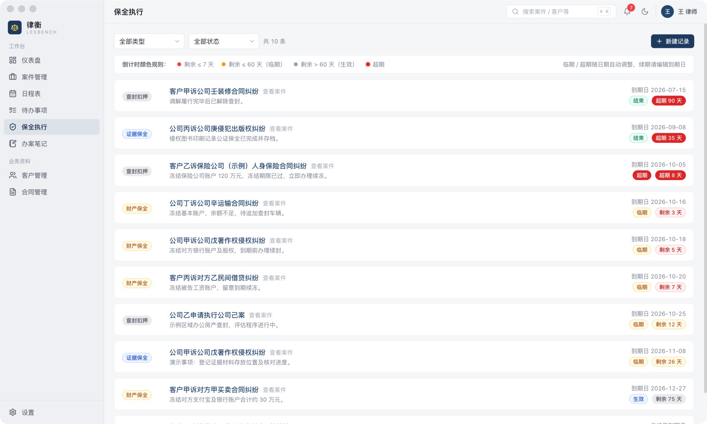

点击右上角「新建记录」，登记保全或执行措施。所属案件必填；类型可选财产保全、行为保全、证据保全、先予执行、查封扣押；另可填写到期日与备注（进展说明）。列表可按类型和状态筛选。

进展状态由您手工选择，分三种：

- **申请**：已准备或已提出申请，尚未采取措施，到期日可以不填。
- **生效**：措施已采取，必须填写到期日。系统按到期日自动显示为「生效」（剩余超过 60 天）、「临期」（剩余 60 天内，含到期当天）或「超期」（到期日已过）。
- **结束**：措施已了结，无需继续跟进，到期日可以不填。

页面顶部显示倒计时颜色规则。**到期日由您手工录入；续期请编辑到期日。** 保全执行记录不能在应用内删除，办结后请将状态改为「结束」。

所有未结束且填写了到期日的记录，都会按剩余天数排列在仪表盘「保全 / 执行到期预警」中，并显示在提醒中心；剩余 7 天内或已超期的记录会计入提醒红点，并发送系统通知（见第十一章）。

## 九、办案笔记

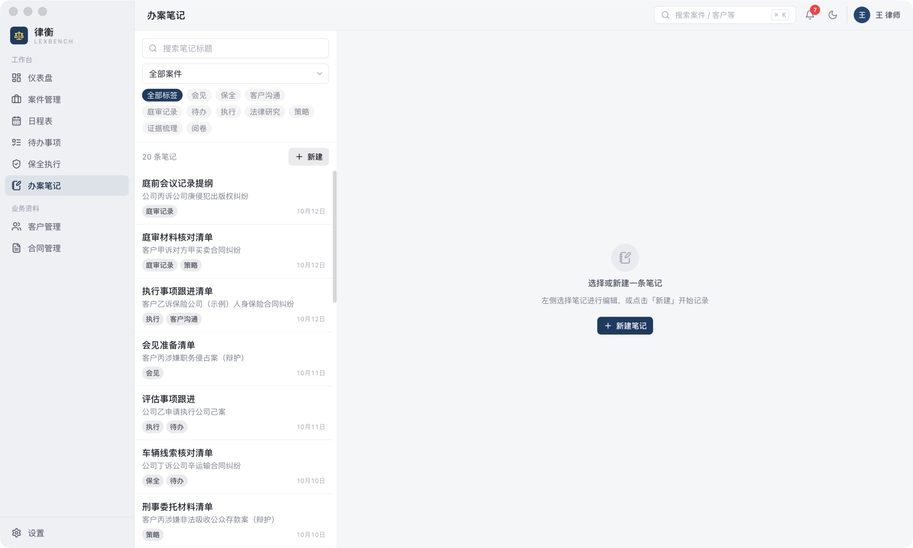

左侧为笔记列表，可按标题搜索、按所属案件和标签筛选；右侧为编辑器。新建笔记时标题和所属案件必填，标签可选填，多个标签用逗号分隔。笔记必须归属于一个案件，请先建立案件。笔记支持 Markdown，可在「编辑 / 预览」之间切换。

- **草稿自动保存**：编辑停顿约 1.5 秒后自动保存草稿（底部显示「草稿已保存 HH:mm:ss」），切换笔记或离开页面也会保存。再次打开时如有较新的草稿，会提示「恢复草稿」或「丢弃草稿」。尚未正式保存过的新笔记，草稿同样可以找回。
- **正式保存**：点击「保存」，写入完成后显示「已保存 HH:mm:ss」，对应草稿自动清除。
- **历史版本**：每次正式修改保存都会留存快照，首次修改时同时保留原文；每篇笔记保留最近 20 个版本。点击「历史」可只读查看任一版本、与当前内容并排比较，或「恢复为副本」（在原案件下生成新笔记，不覆盖现内容）。
- **删除笔记**：需确认，删除后该笔记的草稿与全部历史版本一并删除。

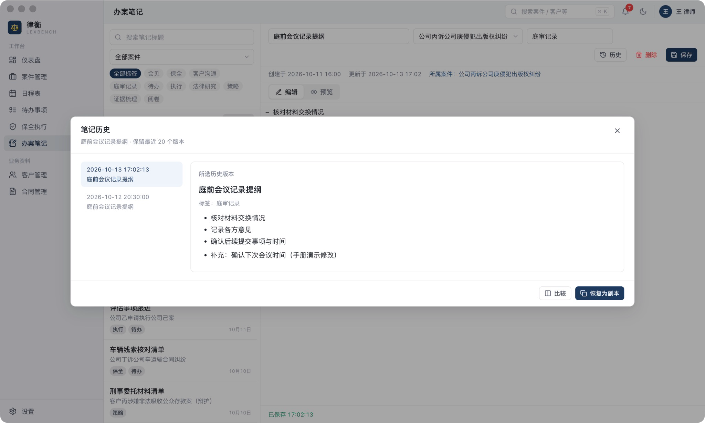

注意：自动草稿有约 1.5 秒等待时间，进程被强制结束或断电时，尚未写入的内容可能丢失，重要内容请确认保存时间。

## 十、全局搜索

点击顶栏搜索框或按 ⌘K（Windows：Ctrl+K）打开全局搜索。输入关键词，多个词用空格分隔时需全部命中；匹配不区分大小写，支持输入单个汉字。搜索范围如下：

| 类别 | 匹配内容 |
| --- | --- |
| 案件 | 案件名称、案号、对方当事人、委托人名称、受理法院 / 仲裁委 |
| 客户 | 名称、电话、邮箱、地址 |
| 合同 | 合同名称、合同编号 |
| 笔记 | 标题、正文 |
| 待办 | 标题 |
| 日程 | 标题、地点 |
| 保全 | 类型、所属案件名称 |

附件的文件名和内容不在搜索范围内。

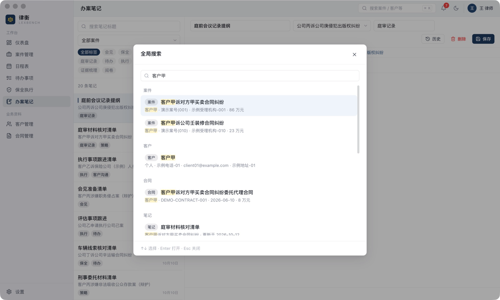

结果按类别分组，每组最多显示 5 条并标注总数；命中文字高亮，笔记显示命中摘要。用 ↑↓ 选择、Enter 打开、Esc 关闭。案件、客户、合同打开对应详情页；笔记在办案笔记页选中；待办、保全打开编辑弹窗；日程跳转到所在月份并打开编辑弹窗，待办自动生成的日程只显示提示。

## 十一、期限提醒

### 11.1 提醒范围

提醒依据您手工录入的日期，覆盖以下三类：

- 未完成且设有期限的待办
- 未结束且填写了到期日的保全执行记录
- 未来 30 天内开始的日程（包括待办自动生成的日程）

案件的「下次关键节点」、合同收费期次的应收日期不在提醒范围内。需要提醒时，请为其另建带期限的待办。

### 11.2 提醒中心

点击顶栏铃铛打开提醒中心，条目分为「已逾期」「7 天内」「60 天内」「60 天后」「日程安排」五组。铃铛上的未读数只统计待办与保全中「已逾期」和「7 天内」的条目；打开面板即标记为已读。点击条目可跳转到对应记录。

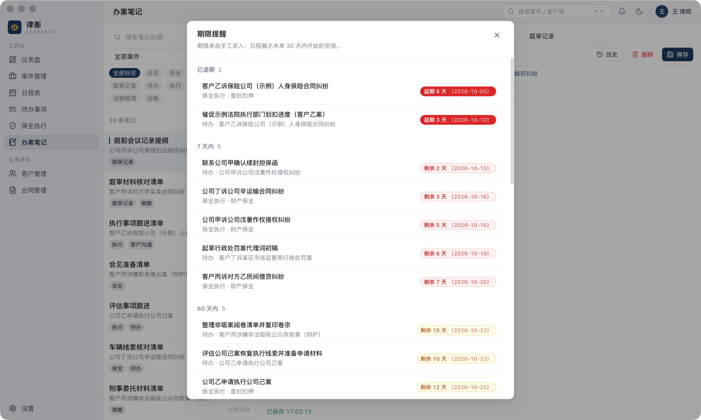

### 11.3 系统通知

待办与保全进入「7 天内」或「已逾期」时，应用会通过 macOS / Windows 通知中心推送提醒。检查时机为应用启动时、每 30 分钟一次、窗口重新获得焦点时；同一期限在同一档位只发送一次，期限改为新日期后会重新提醒。点击通知会显示并切换到律衡主窗口。日程不发送系统通知。

运行边界：

- 应用**完全退出**期间不推送；macOS 关闭窗口后应用仍在运行，完全退出请用 ⌘Q；Windows 关闭最后一个窗口即退出。下次启动时按当前数据补发。
- 系统休眠期间不推送，唤醒后由定时检查或窗口获得焦点时的检查补上。
- 通知显示受系统通知授权、勿扰/专注模式影响。设置中可分别关闭「系统通知」和「应用内红点」。
- 提醒依据您手工录入的期限，不计算、不核对法定期限。

## 十二、设置、演示数据与数据管理

点击左下角「设置」打开设置面板。

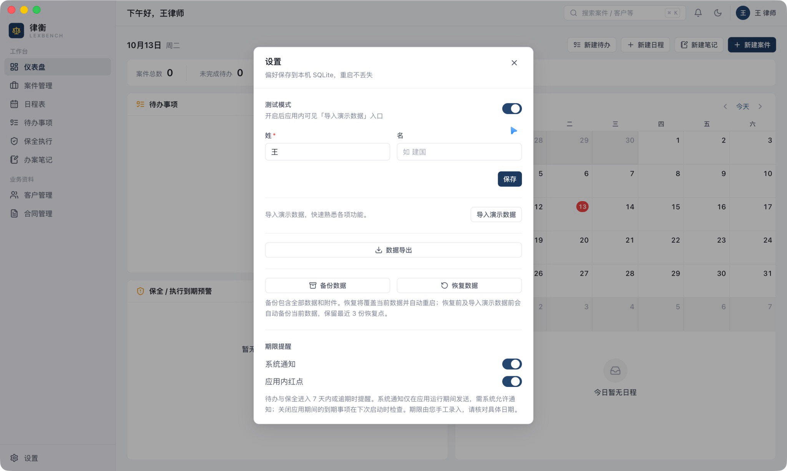

### 12.1 姓名

修改姓（必填）/名（可空），保存后立即生效；问候语展示姓（如「下午好，王律师」），头像展示完整姓名。

### 12.2 测试模式与演示数据

开启「测试模式」后，面板中出现「导入演示数据」入口。点击并确认后，应用先为当前数据生成一份自动恢复点，再导入一批**完全虚构**的示例客户、案件、合同、待办、日程、保全与笔记（如「客户甲」「公司甲（示例）」）。导入是一次性操作，完成后入口不再显示。

使用前请注意：

- 演示数据会与现有数据合并在一起，导入前不要求数据库为空。
- 演示数据中的案件、客户和保全记录无法在应用内删除（见第 3.3 节）。如需清除演示数据，请用「恢复数据」选择导入前自动生成的恢复点（位于数据目录的 `backups/` 中，见第 13.1 节）。恢复会把全部数据退回到导入前的状态，导入后录入的内容也会一并清除。
- 建议只在尚未录入正式内容时导入演示数据。
- 演示数据中的附件只有文件信息，没有文件内容。

### 12.3 数据导出（Excel + 附件 ZIP）

点击「数据导出」并选择目录，生成 `律衡导出-YYYYMMDD-HHmm/`：内含十张表的 `律衡数据.xlsx`（金额以元为单位、日期可排序），有附件时另含 `附件.zip`。导出只读取数据，不修改数据库，适合交接、审计或自行分析。**导出不能当作备份**：它不包含笔记草稿/历史、提醒记录等全部内部状态，不能用导出文件把应用恢复到原状。

### 12.4 备份与恢复

**容量上限**：本版本的备份 ZIP 文件最大 256 MiB，解压后内容总量最大 512 MiB，单个文件最大 256 MiB，清单最大 4 MiB，条目最多 20,000 个。附件中扫描件较多时容易接近上限，请定期留意备份是否成功。超出上限时，备份会直接失败并提示原因。此时可先完全退出应用，将整个数据目录（见第 13.1 节）复制到加密的外部存储作为补充备份；在应用外整理、压缩大体积附件后，再重新执行「备份数据」。

- **备份数据**：选择目录后生成 `律衡备份-YYYYMMDD-HHmm.zip`，包含数据库、全部附件及校验清单。备份期间应用进入只读状态。生成备份时需要额外的磁盘空间暂存文件。
- **恢复数据**：选择备份 ZIP，应用先做完整性与版本预检，通过后显示覆盖确认。点击「恢复并重启」后，应用先把当前数据自动保存为恢复点（保留最近 3 份），再替换数据并自动重启。**恢复会整体替换当前数据，操作前请确认备份选择无误。** 恢复时会把整个备份文件读入内存。
- 恢复点保存在您本机数据目录的 `backups/` 中，文件名为 `恢复点-YYYYMMDD-HHmm.zip`，也可以作为备份文件被「恢复数据」选用。

备份生成时会预检容量并拒绝超限内容；恢复时会在临时目录预检，并拒绝超限、篡改或损坏的备份。请使用虚构资料在隔离环境试恢复，确认可用后再依赖该备份。

## 十三、数据位置、备份迁移与常见问题

### 13.1 数据位置

- macOS：`~/Library/Application Support/律衡/`
- Windows：`%APPDATA%\律衡\`

目录中包括数据库 `lexbench.db`（运行时另有 `-wal`、`-shm` 两个附属文件）、附件目录 `attachments/` 与恢复点目录 `backups/`。

数据库与附件**未做应用层加密**，任何能读取您电脑账户的人都能打开。请启用系统全盘加密（macOS 文件保险箱 / Windows BitLocker），并妥善保管导出的 Excel、ZIP 与备份文件。详见 [数据与隐私说明](data-and-privacy.md)。

### 13.2 升级与迁移

本测试版无自动更新：下载新版本安装包覆盖安装即可，数据目录保持不变，数据库结构如有变化会在首次启动时自动升级。

- 升级前请先「备份数据」。
- 新版本升级过的数据库，请勿再用旧版本打开。如需退回旧版本，请在旧版本中恢复升级前生成的备份。
- 新版本生成的备份，如果数据库版本高于当前应用支持的版本，旧版本会拒绝恢复，并提示使用较新版本。

换机时：在新机器安装相同或更高版本的律衡，用「恢复数据」导入旧机器的备份 ZIP（恢复点亦可）。macOS 与 Windows 之间的互相恢复尚未完成验证，请先用虚构资料试恢复。

卸载程序默认保留数据目录；如需彻底删除，请手动删除上述数据目录。

### 13.3 常见问题

- **macOS 提示无法打开**：按第 2.2 节核对来源、哈希与开发者身份提示；提示损坏或恶意软件时停止安装并反馈。
- **Windows SmartScreen 拦截**：按第 2.2 节核对来源和哈希后决定是否试用。
- **收不到系统通知**：检查系统通知授权与勿扰模式；确认设置中「系统通知」已开启；应用完全退出期间不推送。案件「下次关键节点」、收费应收日期与日程不发送系统通知（见第 11.1 节）。
- **案件显示「超期」但实际未到期**：检查该案件的「下次关键节点」。未填写时系统按收案日期保存，请编辑案件填入实际日期。
- **农历显示异常**：农历由系统区域历法计算，支持 1900–2100 年；请确认系统时间正确。
- **恢复失败**：预检不通过时不会替换当前数据，并显示中文原因；损坏、超限或非本应用备份会被拒绝。替换期间发生错误时应用会尝试回滚，请保留原备份、恢复点与错误信息，确认原数据可用后再继续。
- **如何重置全部数据**：先「备份数据」，并把需要保留的备份和 `backups/` 中的恢复点复制到数据目录以外的位置（删除数据目录时，其中的恢复点会一并删除）；然后完全退出应用（macOS 按 ⌘Q，Windows 关闭窗口）；最后删除第 13.1 节所列的数据目录。此操作不可撤销。

### 13.4 问题反馈

- 功能问题与建议：GitHub Issues（<https://github.com/OberynKC/LexBench/issues>）。**请勿在 Issue 中粘贴案件数据、当事人信息或附件。**
- 安全漏洞：请按 [SECURITY.md](../SECURITY.md) 私下报告，邮箱 kangchen.1019@gmail.com。
